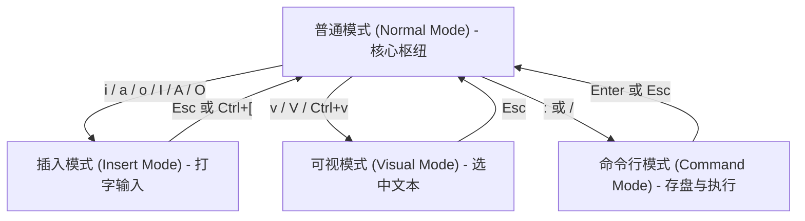

`Gmeek-html`

# Vim 光标操作与常用快捷键速查笔记

## 写在前面

> 最近在学习 Python，环境用的是云端 Linux 服务器，跟着 oeasy 老师用 Vim 编辑器。碍于之前用 Git 合并时，命令行总是弹出提示输入 merge 信息，默认也是 Vim 文本编辑器，导致只会 `:q` 的我每次都不写 merge info。因为一旦进入了 Vim 的 insert 模式，我就不能通过 `Ctrl`、`Shift`、`Home/End`、`↑/↓/←/→` 这些按键组合方式移动光标了，一旦写错，编辑起来十分痛苦。
>
> 每次看到有大佬用 Vim 健步如飞地写代码，都有一种敬畏感。之前读过一篇 [采访Snipaste开发者](https://sspai.com/post/35097) 的文章，其中有句话我很认同：
> > 如果想要学会一个高级工具，那学习成本自然也是要的，世界上并不存在不需要学习成本但却很强大的工具。
> > 强大的工具通常还有一个共性，就是一旦你掌握了它，它带给你的回报远远超过你当时付出的时间和精力成本。


我愿意花时间适应 Vim，主要是图这几点：
1. **轻量快速**：打开和关闭大文件几乎瞬间完成，没有多余的卡顿。
2. **到处都有**：Linux 和 macOS 默认自带，远程连服务器不需要配图形界面就能改配置；另外 VSCode、Obsidian 也都有 Vim 插件，学会一套按键习惯，在各个工具里都能用上。
3. **生态成熟**：需要轻量编辑时它是个利索的终端编辑器，真要深度折腾，配上插件也能当完整的 IDE 用。

> [!NOTE]
> 最大的成本就是刚上手时的习惯冲突。以前在普通编辑器里习惯了用鼠标点、用方向键挪光标，到 Vim 里容易发懵。整理这篇笔记，主要是梳理清楚它的核心操作逻辑，平时遇到忘了的按键也可以随时翻翻表格速查。

---

## 1. 搞懂 Vim 的基本逻辑：模式与操作语法

刚开始用 Vim 很容易觉得快捷键多且杂，其实只要摸清它的**四种模式**和**组合规律**，绝大部分按键就不用死记硬背了。

### 1.1 四种常用模式

Vim 把日常编辑拆分成了不同的状态，最核心的是以下四种：



* **普通模式（Normal Mode）**：打开文件后的默认状态。这个模式下按键不是在打字，而是在发号施令（移动光标、复制、删除）。
* **插入模式（Insert Mode）**：像普通记事本一样正常打字的模式，按 `i`、`a`、`o` 进入，按 `Esc` 或 `Ctrl + [` 回到普通模式。
* **可视模式（Visual Mode）**：用来高亮选中文本（选字符、选整行或框选列块）。
* **命令行模式（Command-line Mode）**：在普通模式输入 `:`、`/` 进入，用于存盘、退出、查找和正则批量替换。

### 1.2 组合语法：动词 + 名词

Vim 的很多操作其实是类似英语语法的拼接：

$$\text{操作指令} = [\text{执行次数}] + \text{动词（操作符）} + \text{名词（移动范围 / 文本对象）}$$

* **常见动词**：
  * `d`：Delete（删除 / 剪切）
  * `c`：Change（修改：删掉并立刻进入打字模式）
  * `y`：Yank（复制）
  * `v`：Visual（选区高亮）
* **常见名词**：
  * `w`：Word（单词）
  * `$`：行尾
  * `iw`：Inner Word（当前单词内部）
  * `i"`：引号内部的内容

> [!TIP]
> * `d` + `w` = 删到下一个单词开头
> * `c` + `i` + `w` = 把当前光标所在的单词删掉并开始打字
> * `y` + `$` = 复制从光标到行尾的内容
> * `3` + `d` + `d` = 连续删 3 行
> 
> 按照这种规律，想做什么操作自己拼出来即可，不需要把每一种排列组合当成单独的快捷键去背。

---

## 2. 最基础的操作：输入、保存与退出

### 2.1 进入与退出输入模式

| 操作 | Vim 快捷键 | 记忆提示 | 说明 |
| :--- | :--- | :--- | :--- |
| **光标前打字** | `i` | **I**nsert | 在当前光标字符前面开始输入 |
| **光标后追加** | `a` | **A**ppend | 在当前光标字符后面开始输入 |
| **下方新建一行** | `o` | **O**pen line below | 在当前行下面另起一行并开始输入 |
| **跳到行首打字** | `I` | 大写 Insert | 光标直接跳到本行第一个有效字符前开始输入 |
| **跳到行尾追加** | `A` | 大写 Append | 光标直接跳到本行末尾开始输入 |
| **上方新建一行** | `O` | 大写 Open line | 在当前行上面插入新行并开始输入 |
| **回到普通模式** | `Esc` 或 `Ctrl+[` | Escape | 退出打字或选中状态，回到普通模式（最常用的键） |

### 2.2 保存文件与退出

在普通模式下输入 `:` 进入命令行执行：

| 操作 | Vim 命令 | 说明 |
| :--- | :--- | :--- |
| **保存文件** | `:w` | 把当前修改写入文件 |
| **退出 Vim** | `:q` | 没有未保存修改时安全退出 |
| **保存并退出** | `:wq` 或 `ZZ` | 写入并退出；普通模式下直接按大写 `ZZ` 更快 |
| **不保存强制退出** | `:q!` | 彻底放弃刚才所有改动直接退出（改乱了重来时用） |
| **打开/新建文件** | `:e <文件名>` | 打开指定路径的文件进行编辑 |

### 2.3 撤销与重做

| 操作 | Vim 快捷键 | 记忆提示 | 说明 |
| :--- | :--- | :--- | :--- |
| **撤销上一步** | `u` | **U**ndo | 撤销刚才的修改（按一次退一步） |
| **重做（反撤销）** | `Ctrl + r` | **R**edo | 恢复刚才被撤销的操作 |

---

## 3. 光标移动：别再用方向键了

Vim 快就快在手不用离开主键盘区。

### 3.1 为什么用 hjkl 移动？


在普通模式下移动光标主要靠 **`h` `j` `k` `l`**：
* **`h`**：向左
* **`j`**：向下（长得像向下的箭头，食指自然放的位置）
* **`k`**：向上
* **`l`**：向右

> [!NOTE]
> 当年 Bill Joy 写 `vi` 时用的 [ADM-3A](http://www.aeagean.com/2019/04/13/unix/unix_why_vim_uses_hjkl_to_move_cursors/) 终端键盘上根本没有独立的方向键，`h/j/k/l` 键帽上本身就印着箭头。而且这四个键正好在右手默认放的地方，打字写代码时不需要抬手去够方向键或鼠标，不会打断思路。

### 3.2 按单词移动

跨单词跳比一个一个字符按 `h` 或 `l` 快得多：

| 操作 | Vim 快捷键 | Windows / 常见编辑器按键 | 说明 |
| :--- | :--- | :--- | :--- |
| **跳到下个词首** | `w` | `Ctrl + →` | **W**ord：跳到下一个单词开头 |
| **跳到上个词首** | `b` | `Ctrl + ←` | **B**ack：跳到上一个单词开头 |
| **跳到词尾** | `e` | -- | **E**nd：跳到当前或下一个单词结尾 |
| **反向跳到词尾** | `ge` | -- | 反向跳到上一个单词结尾 |

> [!TIP]
> 如果遇到类似 `user.login_name[0]` 这种带标点的变量名，小写 `w/b/e` 会把点和括号都当成独立的词停顿；换成大写的 **`W` / `B` / `E`**，就会把整串连着的非空字符当成一个大单词跳过（只以空格为间隔）。

### 3.3 行内移动

#### ① 行首与行尾的选择

| 操作 | Vim 快捷键 | Windows / 常见编辑器按键 | 说明 |
| :--- | :--- | :--- | :--- |
| **跳到绝对行首** | `0` | `Home` | 回到本行第 1 列（即使前面有缩进空格） |
| **跳到首个有效文字** | `^` | `Home` + `Ctrl+→` | 跳过开头的缩进空格，停在第一个实际字符上 |
| **跳到绝对行尾** | `$` | `End` | 跳到本行最后一个字符（包括尾随空格） |
| **跳到末尾有效文字** | `g_` | -- | 忽略末尾空格，停在最后一个有效字符上 |

> [!TIP]
> 比如有一行带缩进的代码：
> ```text
>     print("Hello")  
> ```
> * 按 **`0`**：光标停在最前面的缩进空格上；
> * 按 **`^`**：光标直接落在字母 **`p`** 上（写代码日常基本都用 `^`）；
> * 按 **`$`**：光标停在行尾后面的空格上；
> * 按 **`g_`**：光标直接落在末尾的括号 **`)`** 上。

#### ② 行内单字符定位（f 和 t）
如果一行比较长，想迅速跳到某个符号上：
* **`f{字符}`**：向后找到目标字符并停在上面（**F**ind）。比如光标在行首，按 `f"` 可以直接瞬移到本行下一个双引号处。
* **`F{字符}`**：向前反向查找字符。
* **`t{字符}`**：跳到目标字符的前一个位置（**T**ill，常配合删除使用，比如 `dt;` 删到分号前）。
* **`;`**：重复刚才的 `f` 或 `t` 查找。
* **`,`**：反向重复刚才的查找。

### 3.4 跨行与翻页

| 操作 | Vim 快捷键 | Windows / 常见编辑器按键 | 说明 |
| :--- | :--- | :--- | :--- |
| **跳到文件开头** | `gg` | `Ctrl + Home` | 跳到第 1 行 |
| **跳到文件末尾** | `G` | `Ctrl + End` | 跳到最后一行 |
| **跳到指定行** | `:[行号]` 或 `[行号]G` | `Ctrl + G` | 比如 `:50` 或 `50G` 直接跳到第 50 行 |
| **向下滚动半屏** | `Ctrl + d` | -- | **D**own：向下滚半页（看代码最常用） |
| **向上滚动半屏** | `Ctrl + u` | -- | **U**p：向上滚半页 |
| **向下翻整页** | `Ctrl + f` | `Page Down` | **F**orward：向下翻一页 |
| **向上翻整页** | `Ctrl + b` | `Page Up` | **B**ackward：向上翻一页 |
| **跳到下一段/空行** | `}` | -- | 快速跳过一个函数块或空行 |
| **跳到上一段/空行** | `{` | -- | 快速往上跳过一个段落 |
| **跳到上次修改所在行** | `'.` | -- | 回到上次修改所在行的开头有效字符 |
| **跳到上次修改精确点** | `` `. `` | -- | 精确回到上次修改时的具体光标位置 |
| **跳回上次修改并继续打字** | `gi` | -- | 直接回到最后编辑的地方并自动进入插入模式 |
| **跳回前一个位置** | `''` 或 `` `` `` | -- | 比如用 `gg` 跳去开头看完后，连按两次单引号跳回刚才的位置 |

> [!TIP]
> * `:set nu` 显示行号（`:set nonu` 关闭，写进 `~/.vimrc` 里的 `set number` 可永久生效）；
> * `100G` 跳到第 100 行确认位置；
> * `:100,150y` 复制 100~150 行，`:100,150w ~/part.txt` 则把这段导出成单独小文件。

---

## 4. 文本编辑与文本对象（Text Objects）

### 4.1 常用编辑操作

| 操作 | Vim 快捷键 | Windows / 常见编辑器按键 | 助记与说明 |
| :--- | :--- | :--- | :--- |
| **删除单个字符** | `x` | `Delete` | 删掉光标下的单个字符 |
| **复制整行** | `yy` | `Ctrl + C`（未选中文本时） | **Y**ank line |
| **删除/剪切整行** | `dd` | `Ctrl + X` 或 `Ctrl+Shift+K` | **D**elete line |
| **清空整行重写** | `cc` | -- | 删掉整行并直接进入打字模式 |
| **删到行尾** | `D` 或 `d$` | -- | 删掉从当前光标到行末的所有内容 |
| **改到行尾** | `C` 或 `c$` | -- | 删到行末并直接进入打字模式 |
| **粘贴到后面/下方** | `p` | `Ctrl + V` | **P**ut after |
| **粘贴到前面/上方** | `P` | -- | **P**ut before |

### 4.2 文本对象（Text Objects）

日常改代码经常要修改括号里、引号里的内容。传统编辑器要用鼠标拖选或者按着退格键慢慢删，而在 Vim 里可以通过“文本对象”一键操作。

**基本格式**：`[操作符]` + `[i 或 a]` + `[对象]`
* **`i`（inner）**：只修改里面的内容，不包含外面的括号或引号。
* **`a`（around）**：连同外面的括号、引号或空格一起处理。

| 组合命令 | 含义 | 实际效果 |
| :--- | :--- | :--- |
| **`ciw`** | Change Inner Word | 无论光标在这个词的哪个字母上，直接清空该词并开始打字 |
| **`diw`** | Delete Inner Word | 删掉光标所在的整个词 |
| **`yiw`** | Yank Inner Word | 复制光标所在的整个词 |
| **`ci"`** | Change Inner `"` | 清空双引号里的文字并开始输入，保留双引号 |
| **`ca"`** | Change Around `"` | 连同外层双引号一起删掉并开始输入 |
| **`di(`** 或 **`dib`** | Delete Inner `(` | 清空小括号里的参数或表达式 |
| **`da{`** 或 **`daB`** | Delete Around `{` | 把整个大括号连同里面的代码块一起删掉 |
| **`ci<`** 或 **`ci>`** | Change Inner `<` | 清空尖括号 `<...>` 里的内容（常规代码建议优先用它） |
| **`cit`** | Change Inner Tag | 修改成对 HTML 标签（如 `<div>内容</div>`）里的文字 |

> [!TIP]
> * 按 `cit` 没反应，一般是它在上下文里找不到成对的闭合标签：`cit` 里的 `t` 是指 **Tag（标签对）**，比如 `<p>...</p>` 这种。如果是在 Markdown、Python 代码中，或者遇到了单闭合标签 ``、泛型 `vector<int>`，`cit` 就会找不到对象。
> * 日常代码里遇到尖括号 `<...>`，直接用 **`ci<`** 更加通用可靠，不受语言和是否闭合的限制。

---

## 5. 进阶功能

### 5.1 系统剪贴板与寄存器

经常有人遇到这个问题：在 Vim 里用 `yy` 复制的代码，没办法在浏览器里 `Ctrl+V` 贴出来；在外部网页复制的配置，进 Vim 按 `p` 也贴不进去。

**原因**：Vim 默认有一套自己独立的内部剪贴板（叫无名寄存器 `"`），它和操作系统的全局剪贴板默认是不相通的。

#### 系统剪贴板怎么用？

| 操作 | Vim 命令 / 快捷键 | 说明 |
| :--- | :--- | :--- |
| **复制选中文本到系统剪贴板** | `"+y`（可视模式下） | 把选中的内容写入系统剪贴板，外面可以随便贴 |
| **复制整行到系统剪贴板** | `"+yy` | 把当前整行写入系统剪贴板 |
| **从系统剪贴板贴进 Vim** | `"+p` | 把外面复制的内容贴进光标后 |
| **查看历史删除内容** | `:reg 123456789` | 弹窗直接看 1~9 号历史删除内容，不用盲目粘贴 |
| **查看指定寄存器** | `:reg +` 或 `:reg "` | 查看系统剪贴板或默认剪贴板当前存了啥 |
| **查看所有寄存器列表** | `:reg` | 查看所有寄存器的内容快照 |
| **找回历史删除的内容** | `"1p` 到 `"9p` | 按历史序号把刚才删掉的文字粘回来 |

> [!NOTE]
> 在终端输入 `vim --version | grep clipboard`。如果显示 `+clipboard` 说明支持；如果是 `-clipboard`，在 Linux 下一般装一个 `vim-gtk3` 或者直接换用 `neovim` 就能搞定。

### 5.2 可视块模式（批量加注释和对齐）

想给连续多行代码批量加注释或缩进时，不用装插件，Vim 自带的**可视块模式（Visual Block）** 就能搞定。

#### 批量加注释：
1. 光标放到第一行的开头，按 **`Ctrl + v`** 进入块选择；
2. 按 **`j`** 往下选，框住需要注释的行；
3. 按大写的 **`I`**，输入注释符号（比如 `# ` 或 `// `）；
4. 按一下 **`Esc`**（稍等半秒），刚才选中的每一行开头就全加上注释了。

#### 批量删注释：
1. 光标移到首行的注释符上，按 **`Ctrl + v`**；
2. 框选住多行开头的 `#` 或 `//`；
3. 按 **`d`** 即可全部删掉。

### 5.3 调用外部命令

在编辑过程中临时想看个目录或者运行一下脚本，不需要退出 Vim 再进来：

| 命令 | 示例 | 说明 |
| :--- | :--- | :--- |
| **临时跑一条终端命令** | `:!<命令>` | 如 `:!ls -l`，跑完按回车回到 Vim |
| **把外部文件内容读进来** | `:r <文件名>` | 如 `:r snippet.txt`，把该文件直接插入光标下方 |
| **把命令输出直接贴到文档** | `:r !<命令>` | 如 `:r !date "+%Y-%m-%d %H:%M:%S"`，自动打入时间戳 |
| **保存并立刻执行** | `:w \| !python %` | 保存后马上用 Python 跑当前脚本 |

> [!TIP]
> 在 Vim 的命令行里，**`%`** 代表“当前正在编辑的文件名”。比如正在编辑 `test.py`，那么 `:!python %` 实际执行的就是 `python test.py`。

### 5.4 快速搜索与批量替换

#### ① 查找文本
* **`/关键词`**：按下回车向下搜索；
* **`?关键词`**：向上搜索；
* **`n`**：跳到下一个匹配项；
* **`N`**：跳回上一个匹配项；
* **`*`**：直接把光标所在的单词作为关键词向下搜索（查变量在哪些地方用过时很省事）。

#### ② 批量替换（Substitute）
基本语法：`:[范围]s/[旧文字]/[新文字]/[标志]`

| 需求 | 命令写法 | 说明 |
| :--- | :--- | :--- |
| **当前行全部替换** | `:s/old/new/g` | 替换当前行里的每一个 old（`g` 代表 global） |
| **整篇文档全局替换** | `:%s/old/new/g` | 替换全文所有匹配项（`%` 代表整篇文件） |
| **逐个确认再替换** | `:%s/old/new/gc` | 每次替换前停下来问你，按 `y` 换，按 `n` 跳过 |
| **指定行号范围替换** | `:10,30s/old/new/g` | 仅在第 10 到 30 行之间替换 |
| **给每行开头加文字** | `:%s/^/# /g` | `^` 表示行首，相当于全文批量加注释 |
| **给每行末尾加分号** | `:%s/$/;/g` | `$` 表示行尾，批量在行末追加分号 |

---

## 6. 快捷键速查表（备查）

按类别整理如下，方便平时按 `Ctrl + F` 快速检索。

### 1. 基础操作与文件

| 操作 | Vim 快捷键 | Windows / 常见编辑器按键 | 说明 |
| :--- | :--- | :--- | :--- |
| **进入输入模式** | `i` / `a` / `o` | -- | 光标前输入 / 光标后追加 / 下方另起新行 |
| **行首尾输入** | `I` / `A` / `O` | -- | 跳行首输入 / 跳行尾追加 / 上方另起新行 |
| **退出到普通模式**| `Esc` 或 `Ctrl+[` | `Esc` | 回到普通模式（最核心的状态切换） |
| **存盘 / 退出** | `:w` / `:q` / `:wq` | `Ctrl+S` / -- | 保存 / 退出 / 保存并退出 |
| **强制放弃退出** | `:q!` | -- | 放弃修改强行退出 |
| **撤销 / 重做** | `u` / `Ctrl + r` | `Ctrl+Z` / `Ctrl+Y` | 撤销上步改动 / 恢复改动 |

### 2. 光标移动

| 操作 | Vim 快捷键 | Windows / 常见编辑器按键 | 说明 |
| :--- | :--- | :--- | :--- |
| **基础方向** | `h` / `j` / `k` / `l` | `←` / `↓` / `↑` / `→` | 左 / 下 / 上 / 右 |
| **跨单词移动** | `w` / `b` | `Ctrl+→` / `Ctrl+←` | 跳到下个词首 / 跳到上个词首 |
| **行内极值** | `0` / `$` | `Home` / `End` | 跳到绝对行首 / 绝对行尾 |
| **行内有效文字** | `^` / `g_` | -- | 跳到首个有效文字 / 最后一个有效文字 |
| **行内找字符** | `f{字符}` / `;` | -- | 直达目标字符 / 重复查找 |
| **文件首尾** | `gg` / `G` | `Ctrl+Home` / `Ctrl+End`| 跳到文件第 1 行 / 跳到最后一行 |
| **跳到指定行** | `:[行号]` 或 `[行号]G`| `Ctrl+G` | 如 `:42` 跳到第 42 行 |
| **半屏滚动** | `Ctrl + d` / `Ctrl + u` | -- | 向下滚半屏 / 向上滚半屏 |
| **回到编辑处** | `'.` / `` `. `` / `gi` | -- | 回到上次修改所在行 / 精确点 / 回到修改处打字 |
| **跳转前后往返** | `''` 或 `` `` `` | -- | 在大跳跃前后原路返回 |

### 3. 编辑与文本对象

| 操作 | Vim 快捷键 | Windows / 常见编辑器按键 | 说明 |
| :--- | :--- | :--- | :--- |
| **删字符 / 替换** | `x` / `r{字符}` | `Delete` / -- | 删掉当前字符 / 单字符替换 |
| **整行剪切 / 复制**| `dd` / `yy` | `Ctrl+X` / `Ctrl+C` | 剪切整行 / 复制整行 |
| **删到行尾** | `D` 或 `d$` | -- | 删掉光标到行末的所有内容 |
| **粘贴** | `p` / `P` | `Ctrl+V` | 贴到光标后（或下方） / 贴到光标前（或上方） |
| **改单词** | `ciw` / `diw` | 双击 + 改/删 | 清空当前单词并打字 / 删掉当前单词 |
| **改引号内内容** | `ci"` / `ca"` | -- | 清空引号内文字 / 连同引号一起删掉重写 |
| **改括号内内容** | `ci(` / `da{` | -- | 清空小括号内参数 / 删掉整个大括号代码块 |
| **改尖括号内容** | `ci<` / `ca<` | -- | 清空尖括号 `<...>` 内容 / 连同尖括号一起删 |
| **改 HTML 标签** | `cit` / `cat` | -- | 清空成对标签内部内容 / 删掉整对标签 |

### 4. 进阶功能与批量替换

| 操作            | Vim 快捷键 / 命令                | 说明                                            |
| :------------ | :-------------------------- | :-------------------------------------------- |
| **列块选择**      | `Ctrl + v`                  | 进入块选择，配合 `I` 批量加注释，配合 `d` 批量删                 |
| **显示 / 隐藏行号** | `:set nu` / `:set nonu`     | 打开 / 关闭行号（写进 `~/.vimrc` 的 `set number` 可永久生效） |
| **按行号提取片段**   | `:100,150y` / `:100,150w f` | 把 100~150 行复制进寄存器 / 写入独立小文件方便下载               |
| **系统剪贴板**     | `"+y` / `"+p`               | 复制到系统剪贴板 / 从系统剪贴板粘贴                           |
| **预览寄存器**     | `:reg 123456789`            | 弹窗直接看 1~9 号历史删除了什么                       |
| **调终端命令**     | `:!cmd` / `:r !cmd`         | 执行外部终端命令 / 把命令输出插入到文档                         |
| **全文批量替换**    | `:%s/old/new/g`             | 把整篇文档里的所有 old 替换为 new                         |
| **带确认的替换**    | `:%s/old/new/gc`            | 每次替换前提示确认（按 `y` 换，按 `n` 跳过）                   |
| **批量加行首尾**    | `:%s/^/# /g` / `:%s/$/;/g`  | 批量在每行开头加 `# ` / 批量在每行末尾加 `;`                  |
